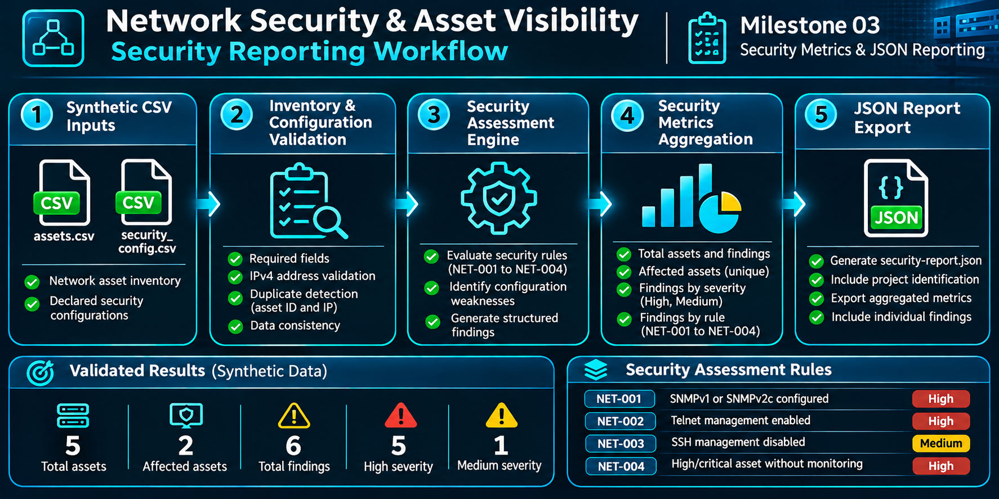
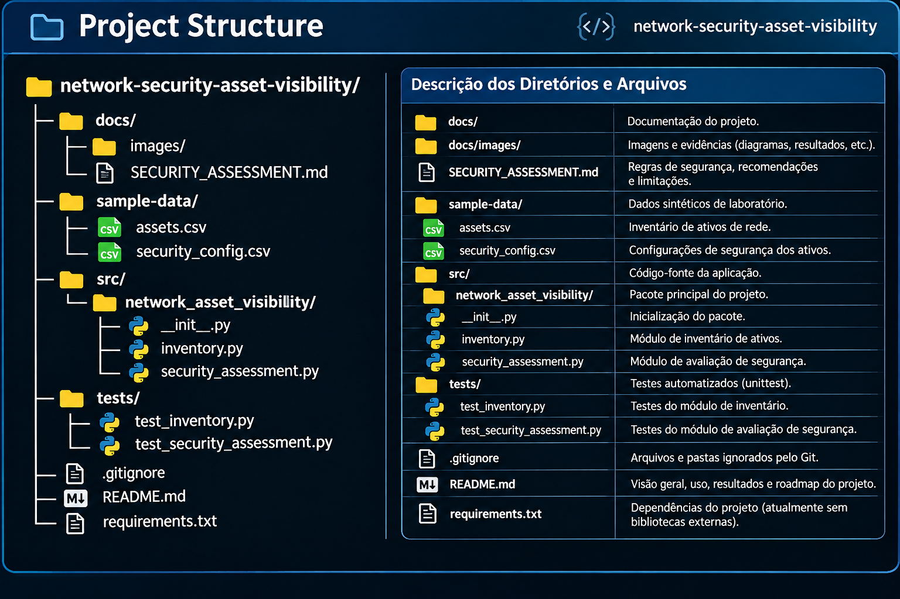

# Network Security & Asset Visibility

**Python-based Network Security Engineering | Asset Inventory | Security Configuration Assessment | Security Metrics & JSON Reporting**

A Security Engineering portfolio project demonstrating how structured network asset information can support infrastructure visibility, security configuration assessment, measurable security indicators, and risk-informed decision-making.

> **Project status:** Milestones 01, 02, and 03 completed, validated, and published on GitHub. The project currently includes network asset inventory, rule-based security assessment, security metrics, JSON reporting, and 25 passing unit tests.

## 1. Project Overview

Network infrastructure security depends on understanding which assets exist, their business criticality, and whether their management configurations follow appropriate security practices.

This project provides an extensible Python-based foundation for network asset inventory, rule-based security assessment, and structured security reporting.

The current implementation processes synthetic CSV datasets, validates asset information, evaluates declared security configurations, generates structured findings, calculates security metrics, and exports JSON reports.

### Key Objectives

- Establish a consistent and validated network asset inventory.
- Identify potentially insecure network management configurations.
- Associate security findings with asset context and criticality.
- Generate measurable security indicators for technical and management reporting.
- Support reproducible security assessments through automated testing.
- Prepare a foundation for dashboards, contextual risk analysis, and authorized network discovery.

## 2. Current Features

### Network Asset Inventory

- CSV-based asset ingestion.
- IPv4 address validation.
- Duplicate asset ID and IP address detection.
- Required-field and input validation.
- Asset criticality classification.
- Inventory statistics by vendor, device type, and criticality.

### Network Security Assessment

- Security configuration ingestion from CSV.
- Detection of SNMPv1 and SNMPv2c configurations.
- Detection of enabled Telnet management.
- Identification of devices with SSH management disabled.
- Identification of high- and critical-priority assets without monitoring.
- Structured findings containing asset ID, hostname, rule ID, severity, and asset criticality.

### Security Metrics & JSON Reporting

- Aggregated security metrics by severity and assessment rule.
- Unique affected asset counting.
- Total asset and finding counts.
- Validation of finding-to-asset references.
- Detection of duplicate asset IDs during metric generation.
- Structured JSON export of metrics and findings.
- Explicit identification of synthetic laboratory data in exported reports.
- Automated reporting tests.

### Automated Validation

- **25 Python unit tests passing in the latest local validation.**
- Inventory validation tests.
- Security configuration and assessment tests.
- Reporting and metric aggregation tests.
- Invalid input and duplicate record tests.
- Empty dataset and unknown asset tests.
- JSON export and data consistency tests.

## 3. Architecture

### Security Reporting Workflow



The current processing workflow consists of five stages:

1. **Asset Inventory:** Load and validate the network asset dataset.
2. **Security Configuration:** Load and validate declared management settings.
3. **Assessment Engine:** Evaluate security rules and associate findings with known assets.
4. **Metrics Aggregation:** Calculate total assets, uniquely affected assets, and finding distributions by severity and rule.
5. **JSON Reporting:** Export structured security metrics and individual findings.

The implementation runs locally without a database, network scanner, or external service.

The architecture separates inventory processing, security assessment, and reporting responsibilities to support future enhancements and maintainability.

## 4. Project Structure



*Repository organization showing source modules, automated tests, documentation, and synthetic laboratory data.*

The project follows a modular Python structure, separating business logic, automated tests, documentation, and sample datasets.

The project structure illustration may be updated as additional modules are introduced.

## 5. Technology Stack

| Technology | Purpose |
|---|---|
| Python 3.14 | Core application development |
| Python Standard Library | CSV processing, IP validation, metric aggregation, and JSON export |
| unittest | Automated testing |
| Git | Version control |
| GitHub | Source code hosting and project documentation |
| PowerShell | Local development and test execution |
| JSON | Structured security report output |

No third-party Python packages are required by the current implementation.

## 6. Getting Started

### Prerequisites

- Python 3.14 (validated development environment)
- Git
- PowerShell for the commands below

### Clone the Repository

```powershell
git clone https://github.com/andersonmartinscyber/network-security-asset-visibility.git
cd network-security-asset-visibility
```

### Create and Activate a Virtual Environment

```powershell
python -m venv .venv
.\.venv\Scripts\Activate.ps1
```

### Configure the Python Module Path

```powershell
$env:PYTHONPATH = (Resolve-Path .\src).Path
```

## 7. Running Automated Tests

From the project root:

```powershell
$env:PYTHONPATH = (Resolve-Path .\src).Path

python -m unittest discover -s tests -v
```

### Latest Validated Execution

```text
Ran 25 tests

OK
```

All 25 tests passed in the latest local validation.

### Test Coverage by Module

| Test Module | Passing Tests |
|---|---:|
| `test_inventory.py` | 5 |
| `test_security_assessment.py` | 12 |
| `test_reporting.py` | 8 |
| **Total** | **25** |

The test suite validates expected behavior, input handling, assessment rules, metric calculations, and JSON report consistency.

## 8. Running the Security Assessment

The project includes two synthetic datasets:

- `sample-data/assets.csv` — Network asset inventory.
- `sample-data/security_config.csv` — Declared security configurations.

Run the assessment using PowerShell:

```powershell
$env:PYTHONPATH = (Resolve-Path .\src).Path

@'
from network_asset_visibility.inventory import load_inventory
from network_asset_visibility.security_assessment import (
    load_security_config,
    assess_security,
)

assets = load_inventory("sample-data/assets.csv")
configs = load_security_config("sample-data/security_config.csv")

findings = assess_security(assets, configs)

for finding in findings:
    print(finding)

print(f"Total findings: {len(findings)}")
'@ | python -
```

The assessment evaluates declared configurations and prints structured findings.

No live network connections are performed.

## 9. Security Assessment Rules

| Rule ID | Security Check | Severity |
|---|---|---|
| NET-001 | SNMPv1 or SNMPv2c configured | High |
| NET-002 | Telnet management enabled | High |
| NET-003 | SSH management disabled | Medium |
| NET-004 | High/critical asset without monitoring | High |

The rule severities are predefined and do not represent CVSS calculations.

SSH being disabled is treated as a configuration review indicator, not proof that a device lacks secure management access.

For detailed rule descriptions, recommendations, and limitations, see [Security Assessment Documentation](docs/SECURITY_ASSESSMENT.md).

## 10. Generating Security Metrics & JSON Reports

The reporting module transforms the asset inventory and assessment findings into aggregated security indicators.

### Generated Metrics

| Metric | Description |
|---|---|
| `total_assets` | Total assets in the validated inventory |
| `affected_assets` | Number of unique assets associated with findings |
| `total_findings` | Total number of security findings |
| `findings_by_severity` | Finding counts grouped by severity |
| `findings_by_rule` | Finding counts grouped by assessment rule |

### Generate a JSON Report

Run the following command from the project root:

```powershell
$env:PYTHONPATH = (Resolve-Path .\src).Path

@'
from network_asset_visibility.inventory import load_inventory
from network_asset_visibility.security_assessment import (
    load_security_config,
    assess_security,
)
from network_asset_visibility.reporting import (
    export_security_report,
)

assets = load_inventory("sample-data/assets.csv")
configs = load_security_config("sample-data/security_config.csv")

findings = assess_security(assets, configs)

report = export_security_report(
    assets,
    findings,
    "security-report.json",
)

print(report["metrics"])
'@ | python -
```

The command generates `security-report.json` in the project root.

This generated report is excluded from Git version control through `.gitignore`.

### Example Metrics

```json
{
  "total_assets": 5,
  "affected_assets": 2,
  "total_findings": 6,
  "findings_by_severity": {
    "high": 5,
    "medium": 1
  },
  "findings_by_rule": {
    "NET-001": 2,
    "NET-002": 2,
    "NET-003": 1,
    "NET-004": 1
  }
}
```

These metrics are part of a larger JSON report containing project identification, data source classification, and individual findings.

For implementation details, test coverage, and limitations, see [Security Reporting Documentation](docs/SECURITY_REPORTING.md).

## 11. Laboratory Validation Results

The current synthetic laboratory dataset includes five network assets.

### Security Assessment Summary

| Metric | Validated Result |
|---|---:|
| Total network assets | 5 |
| Assets with findings | 2 |
| Total security findings | 6 |
| High-severity findings | 5 |
| Medium-severity findings | 1 |
| Automated unit tests | 25 passed |

### Findings by Assessment Rule

| Rule ID | Findings |
|---|---:|
| NET-001 | 2 |
| NET-002 | 2 |
| NET-003 | 1 |
| NET-004 | 1 |
| **Total** | **6** |

The findings demonstrate the behavior of the assessment and reporting engines using controlled laboratory inputs.

**These results are not evidence of vulnerabilities in a production network.**

## 12. Development Milestones

### Milestone 01 — Network Asset Inventory

**Completed and published**

- Initial project structure.
- CSV inventory ingestion.
- IPv4 and duplicate validation.
- Asset classification and inventory metrics.
- Five automated tests.
- Initial Git commit: `6f4a587`.

### Milestone 02 — Network Security Assessment

**Completed and integrated into `main`**

- Security configuration ingestion.
- Four rule-based security checks.
- Structured security findings.
- Expanded test suite: 17 passing tests.
- Technical documentation.
- Project structure image.
- Implementation commit: `14e9725`.

### Milestone 03 — Security Metrics & JSON Reporting

**Completed and integrated into `main`**

- Security metric aggregation.
- Unique affected asset counting.
- Finding distribution by severity and rule.
- JSON report generation.
- Eight additional automated tests.
- Expanded test suite: 25 passing tests.
- Technical reporting documentation.
- Security reporting workflow diagram.
- Implementation commit: `2aade49`.

## 13. Roadmap

- [x] Network asset inventory engine
- [x] IPv4 and duplicate validation
- [x] Asset classification and inventory metrics
- [x] Rule-based security assessment engine
- [x] Automated unit tests for implemented functionality
- [x] Security metrics and JSON reporting implementation
- [ ] Asset configuration coverage analysis
- [ ] Contextual risk prioritization
- [ ] Security dashboard and visualization
- [ ] Authorized SNMPv3 laboratory integration
- [ ] Optional LibreNMS integration
- [ ] GitHub Actions continuous integration

## 14. Known Limitations

- No live network discovery or scanning.
- No direct SNMP collection.
- Configuration data is supplied through CSV files.
- Configuration accuracy is not independently verified against network devices.
- No firmware vulnerability assessment.
- No device-specific security baseline evaluation.
- No automatic verification that every inventory asset has a configuration record.
- No persistent findings database.
- No remediation tracking.
- No graphical dashboard in the current implementation.
- No contextual risk scoring in the reporting module.
- JSON reports do not currently include schema version identifiers or execution timestamps.
- Reporting output is generated locally and is not automatically distributed.

## 15. Security and Ethical Considerations

This project is intended for educational use and authorized Security Engineering laboratories.

- All sample asset and configuration records are synthetic.
- Sample IPv4 addresses use documentation-reserved address space.
- No production credentials or sensitive infrastructure data are included.
- No network scanning or device configuration changes are performed.
- Assessment findings are based on declared data rather than independently verified device states.
- Generated reports are classified as synthetic laboratory output.
- Future network discovery capabilities will be restricted to explicitly authorized environments.

## 16. Future Development

The project is intended to evolve into a broader network security visibility solution that integrates:

- Authorized asset discovery and inventory enrichment.
- Network configuration security assessment.
- Asset configuration coverage analysis.
- Contextual risk prioritization.
- Security metrics and trend analysis.
- Dashboard visualization.
- Automated reporting and continuous integration.
- Integration with network monitoring platforms.

The engineering objective is to demonstrate how network infrastructure information can support asset governance, security monitoring, measurable security posture, and risk-informed decisions.

---

**Repository:** https://github.com/andersonmartinscyber/network-security-asset-visibility

**Current release scope:** Milestones 01–03 — Network Asset Inventory, Security Assessment, and JSON Reporting.

**Validation:** 25 passing automated unit tests in the latest local execution.

**Data classification:** Synthetic laboratory data.