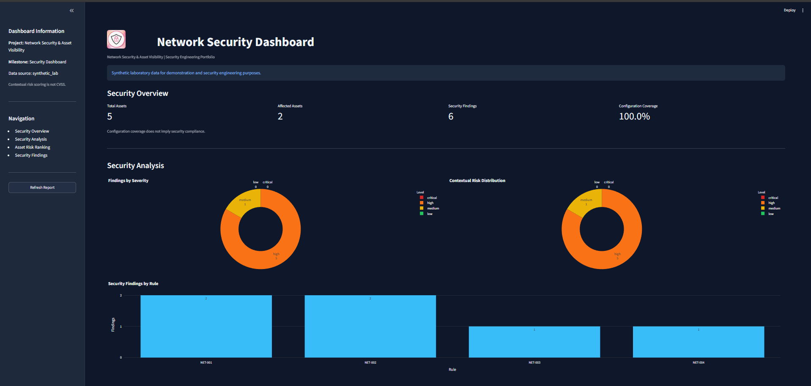
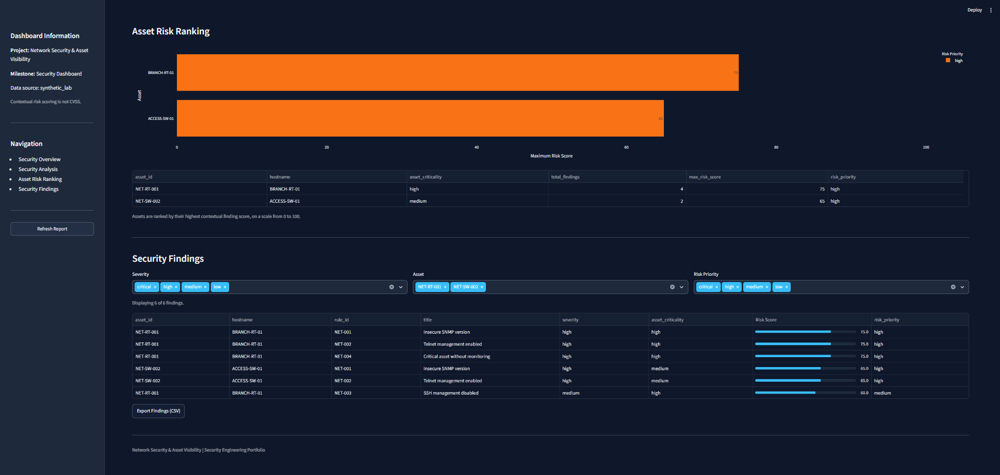

# Security Dashboard & Visualization

## Overview

The Security Dashboard provides an interactive visualization
layer for the Network Security & Asset Visibility platform.

It transforms structured security assessment reports into
actionable security indicators, contextual risk analysis,
asset prioritization, and remediation insights.

## Objectives

- Improve network security visibility.
- Centralize security assessment results.
- Support risk-based remediation decisions.
- Identify affected network assets.
- Provide interactive security findings analysis.
- Enable filtered security data export.

## Technology Stack

| Technology | Purpose |
|---|---|
| Python 3.14 | Core programming language |
| Streamlit | Interactive dashboard |
| Plotly | Security data visualization |
| Pandas | Data transformation |
| JSON | Structured security reports |
| unittest | Automated testing |
| Streamlit AppTest | Interface testing |
| GitHub Actions | Continuous integration |

## Architecture

The dashboard consumes JSON security reports generated
by the security assessment and reporting modules.

The data layer validates report integrity before exposing
security metrics to the visualization layer.

The dashboard reuses the existing contextual risk
prioritization engine to validate calculated risk scores.

## Security Indicators

The dashboard provides four global indicators:

- Total Assets
- Affected Assets
- Security Findings
- Configuration Coverage

Global indicators remain independent of interactive
findings filters.

## Security Analysis

The visualization layer provides:

- Findings by severity.
- Contextual risk distribution.
- Findings grouped by security rule.
- Asset risk ranking.

Severity and contextual risk priority are presented
as separate security dimensions.

## Contextual Risk Scoring

Risk scores are calculated using the existing weighted
risk prioritization model:

Risk Score = Severity Weight * 0.60
           + Asset Criticality Weight * 0.40

Risk scores range from 0 to 100.

| Risk Priority | Score Range |
|---|---|
| Critical | 85–100 |
| High | 65–less than 85 |
| Medium | 40–less than 65 |
| Low | 0–less than 40 |

This scoring model is a contextual prioritization
heuristic and does not represent CVSS.

## Asset Risk Ranking

Affected assets are ranked according to their highest
contextual finding score.

The ranking includes:

- Asset identifier.
- Hostname.
- Asset criticality.
- Total findings.
- Maximum contextual risk score.
- Risk priority.

Using the maximum score preserves the normalized
0–100 scale.

## Interactive Filters

Security findings can be filtered by:

- Severity.
- Asset identifier.
- Contextual risk priority.

Filters can be combined without modifying the
global security indicators.

## Data Export

Filtered findings can be exported as CSV files.

The export contains the currently selected security
findings and their associated contextual risk information.

## Report Integrity

The dashboard validates:

- Required report fields.
- Report structure.
- Asset and finding counts.
- Severity classifications.
- Configuration coverage percentage.
- Risk score ranges.
- Risk priority classifications.
- Consistency between original and prioritized findings.

Invalid or missing reports are handled through
user-facing error messages.

## Local Execution

Install the project dependencies:

```bash
python -m pip install -r requirements.txt
```

Ensure that a valid security-report.json file has
been generated in the project root.

### Windows PowerShell

```powershell
$env:PYTHONPATH = (Resolve-Path .\src).Path

python -m streamlit run dashboard.py --server.address 127.0.0.1 --server.port 8501
```

### Linux

```bash
export PYTHONPATH="$PWD/src"

python -m streamlit run dashboard.py --server.address 127.0.0.1 --server.port 8501
```

Access the dashboard at:

http://127.0.0.1:8501

## Laboratory Results

The synthetic security assessment produces:

| Metric | Result |
|---|---:|
| Total Assets | 5 |
| Affected Assets | 2 |
| Security Findings | 6 |
| Configuration Coverage | 100% |
| High Severity Findings | 5 |
| Medium Severity Findings | 1 |

### Asset Prioritization

| Asset | Findings | Maximum Risk Score |
|---|---:|---:|
| BRANCH-RT-01 | 4 | 75.0 |
| ACCESS-SW-01 | 2 | 65.0 |

## Automated Testing

The project currently includes 97 automated tests:

| Test Category | Tests |
|---|---:|
| Core platform modules | 54 |
| Dashboard data layer | 31 |
| Dashboard interface | 12 |
| Total | 97 |

Execute the complete test suite:

```bash
python -m unittest discover -s tests -v
```

Dashboard interface tests use isolated temporary
directories and synthetic reports.

## Functional Acceptance

| Validation | Status |
|---|---|
| Global security indicators | Passed |
| Severity and risk charts | Passed |
| Asset risk ranking | Passed |
| Individual filters | Passed |
| Combined filters | Passed |
| Empty result handling | Passed |
| CSV export | Passed |
| Report refresh | Passed |
| Visual identity | Passed |
| Global metric consistency | Passed |

## Security Considerations

- The application uses synthetic laboratory data.
- Configuration coverage does not imply compliance.
- Contextual risk scoring does not replace CVSS.
- Local execution is restricted to the loopback interface
  when using the documented startup command.
- Generated security reports are excluded from Git tracking.
- Streamlit usage statistics are disabled in the project configuration.


## Dashboard Screenshots

The following screenshots demonstrate the implemented
security dashboard using synthetic laboratory data.

### Security Dashboard — View 01



### Security Dashboard — View 02



## Limitations

- The dashboard consumes generated JSON reports.
- It does not perform live network discovery.
- It does not execute vulnerability scans.
- Asset ranking includes affected assets with prioritized findings.
- Authentication and authorization are not implemented.
- Report consistency validation does not provide
  cryptographic authenticity or tamper protection.
- CSV export is currently validated through manual
  functional acceptance tests.

## Milestone

Milestone 06 — Security Dashboard & Visualization

**Author:** Anderson Martins dos Santos